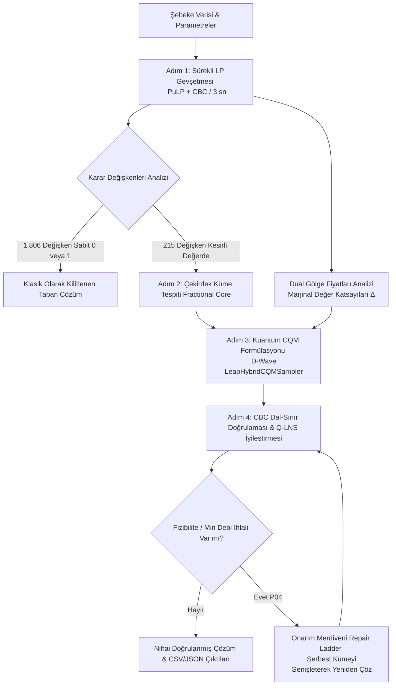

# 🌊 TEKNOFEST Kuantum Hackathonu — Su Dağıtım Şebekesi Optimizasyonu

[](https://www.python.org/)
[](https://cloud.dwavesys.com/leap/)
[](https://coin-or.github.io/pulp/)
[](https://teknofest.org/)
[](LICENSE)

Bu depo, **TEKNOFEST Kuantum Teknolojileri Yarışması (Yazılım Kategorisi Final Aşaması)** kapsamında geliştirilen matematiksel modelleme, kuantum formülasyonu, klasik-kuantum hibrit boru hattı ve resmi çözüm çıktılarını içermektedir.

---

## 👥 Takım: Henüz Ölçülmedi

**Yıldız Teknik Üniversitesi — Bilgisayar Mühendisliği Bölümü**

* **İsmail Orhan**
* **Onur Kaya**
* **Fatih Eren Sözen**
* **Yahya Semih Koçak**
* **Ahmet Rauf Oktay**

---

## 📋 Proje Özeti ve Problem Tanımları

Gerçek ölçekli bir su dağıtım şebekesinde operasyonel maliyetleri en aza indiren, basınç ve debi kısıtlarını sağlayan ve talep kesintilerini önleyen optimum kaynak/pompa çizelgelemesi hedeflenmiştir. Şebeke büyüklüğü ve karmaşıklığı şu şekildedir:

* **7.141** Düğüm (Nodes)
* **45.702** Yönlü Ark / Boru Hattı (Directed Arcs)
* **221** Su Kaynağı (Sources) & Kaynak Paketleri
* **1.800** Terfi Pompası (Pumps) & Pompa Grupları
* **520** Depo (Tanks)
* **600** Tüketim Bölgesi (Demand Zones)
* **2.021** İkili (Binary) Karar Değişkeni

Yarışma kapsamında dört aşamalı problem çözülmüştür:

| Problem | Kapsam | Kullanılan Yaklaşım | Öne Çıkan Sonuç |
| :--- | :--- | :--- | :--- |
| **Problem 01** | 12 Pompalı Alt Şebekede Kapasite Kısıtlı Pompa Seçimi | QUBO Formülasyonu + İkili Slack Değişkenleri + Simulated Annealing / D-Wave QPU | **4.689,20 TL** maliyet, $1058,0\ \text{m}^3/\text{sa}$ akış (Brute-force ile birebir uyuştu) |
| **Problem 02** | 2.021 İkili Değişkenli Büyük Ölçekli Ağ Akışı Optimizasyonu | Dual Yönlendirmeli Hibrit CQM Boru Hattı (LP Gevşetmesi $\to$ Fractional Core $\to$ D-Wave CQM $\to$ Q-LNS) | **20.294.861,59 TL** maliyet, **%100** talep karşılama, sıfır debi ihlali (96,4 sn) |
| **Problem 03** | 96 Kritik Bölge (Hastane, Sanayi) Öncelikli Su Tahsisi | Çift-Kısıntı Değişkenli Formülasyon + 10x Kritik Ceza Katsayısı | **20.374.671,78 TL** maliyet, Kritik kısıntı cezası: **0 TL** (%100 kesintisiz besleme) |
| **Problem 04** | 5.981 Kapalı/Arızalı Ark Altında Şebeke Dayanıklılığı | Arıza Farkındalıklı Modelleme + Onarım Merdiveni (*Repair Ladder*) Algoritması | **27.268.729,54 TL** maliyet, 5.981 hat kaybına rağmen **%100** talep karşılama |

---

## 🧠 Çözüm Mimarisi: Dual Yönlendirmeli Hibrit Boru Hattı

Problem 2, 3 ve 4'teki 2.021 ikili değişken, güncel kuantum donanımlarının tam bağlı gömme (*full embedding*) sınırlarının üzerindedir. Takımımızın ilk denemesi olan **Benders Ayrıştırması**, sabit ücretli ağ akışlarında Benders kesitlerinin zayıf kalması nedeniyle elenmiştir (Detaylar için [experiments/benders_decomposition](src/experiments/benders_decomposition/)).

Bu deneyimden yola çıkarak geliştirdiğimiz **Dual Yönlendirmeli Hibrit Boru Hattı** şu 4 aşamadan oluşur:



### Yöntemin Önemli İlkeleri
1. **Belirsizliği İzole Etmek:** 2.021 ikili kararın 1.806'sı LP aşamasında belirlenmekte; kuantum donanımı yalnızca belirsizliğin toplandığı **215 değişkenlik çekirdek küme** üzerinde çalıştırılmaktadır.
2. **Dual Bilgi Aktarımı:** LP gevşetmesinin dual gölge fiyatlarından her bir pompanın sistem çapındaki marjinal katkısı ($\Delta_i$) hesaplanarak kuantum modeline aktarılır:
   $$\Delta_i = c_i^{\text{sabit}} + \lambda_{\text{kapasite}} \cdot f_i^{\max} + \mu_{\text{min\_debi}} \cdot f_i^{\min}$$
3. **Tek Yönlü Genişleme Güvencesi:** Serbest karar kümesi yalnızca genişletilir, asla küçültülmez. Bu kural, kuantum adımının uygunluğu (fizibiliteyi) hiçbir koşulda bozmamasını garanti eder.

---

## 📊 Performans ve Karşılaştırma Tablosu

| Metrik | Problem 01 | Problem 02 | Problem 03 | Problem 04 |
| :--- | :---: | :---: | :---: | :---: |
| **Toplam Amaç Değeri (TL)** | **4.689,20** | **20.294.861,59** | **20.374.671,78** | **27.268.729,54** |
| **LP Alt Sınırı (TL)** | — | 14.306.185,25 | 14.306.185,25 | 21.035.192,53 |
| **Optimallik Boşluğu (Gap %)** | %0,00 | %41,86 | %42,42 | %29,63 |
| **Aktif Pompa Sayısı** | 5 / 12 | 153 / 1.800 | 178 / 1.800 | 141 / 1.800 |
| **Aktif Kaynak Sayısı** | — | 82 / 221 | 82 / 221 | 76 / 221 |
| **Talep Karşılama Oranı** | %100 | %100,00 | %100,00 | %100,00 |
| **Kritik Kısıntı Cezası** | — | — | **0 TL** | 0 TL |
| **Minimum Debi İhlali (m³)** | 0.000 | 0.000000 | 0.000000 | 0.000000 |
| **K1–K16 Kısıt Doğrulaması** | UYGUN | UYGUN | UYGUN | UYGUN |
| **Toplam Çözüm Süresi** | 0,38 sn | 96,4 sn | 214,4 sn | 106,2 sn |

> **Not:** Problem 4'teki LP alt sınırının 14,3M TL'den 21,0M TL'ye yükselmesi (%47 artış), 5.981 boru hattının devre dışı kalmasının şebekeye getirdiği gerçek fiziksel maliyeti matematiksel olarak kanıtlamaktadır.

---

## 📁 Dizin Yapısı

```text
├── README.md                          # Proje ana tanıtım ve dokümantasyon dosyası
├── requirements.txt                   # Gerekli Python kütüphaneleri
├── .gitignore                         # Sürüm kontrol dışı bırakılan geçici/önbellek dosyaları
│
├── data/                              # Tekil ve temiz model girdi veri seti (JSON formatı)
│   ├── arc_availability.json          # Ark kullanılabilirlik ve arıza durumları (Problem 04)
│   ├── critical_demands.json          # Kritik bölgeler ve öncelikli talep miktarları (Problem 03)
│   ├── demands.json                   # Normal tüketim bölgesi saatlik talepleri
│   ├── failures.json                  # Ham arıza kayıtları
│   ├── network_arcs.json              # 45.702 şebeke hattı fiziksel özellikleri
│   ├── network_nodes.json             # 7.141 şebeke düğüm koordinatları ve tipleri
│   ├── pumps.json                     # 1.800 terfi pompası kapasite, maliyet ve min debileri
│   ├── small_pump_selection.json      # Problem 01 için 12 pompalı alt şebeke verisi
│   ├── sources.json                   # 221 su kaynağı kapasite ve kademeli paketleri
│   ├── tanks.json                     # 520 su deposu hacim, kritik seviye ve stok parametreleri
│   └── zones.json                     # 600 tüketim bölgesi eşleşmeleri
│
├── docs/                              # Dokümantasyon, Raporlar ve Sunumlar
│   ├── team/                          # Takım teslim belgeleri
│   │   ├── Henuz_Olculmedi_Final_Raporu.pdf   # Kapsamlı final teknik yarışma raporu
│   │   └── Henuz_Olculmedi_Final_Sunumu.pptx  # Jüri final sunum slaytları
│   └── competition/                   # Organizasyon resmi kılavuz ve şartnameleri
│       ├── TK26_Problem_Tanitimi.pptx         # TEKNOFEST problem tanıtım sunumu
│       ├── Gonderi_Formati.pdf                # Resmi teslim format kılavuzu
│       ├── Veri_Seti_Tanitimi.pdf             # Veri seti teknik dokümantasyonu
│       ├── Problem_01_Tanitimi.pdf            # Problem 01 şartnamesi
│       ├── Problem_02_Tanitimi.pdf            # Problem 02 şartnamesi
│       ├── Problem_03_Tanitimi.pdf            # Problem 03 şartnamesi
│       └── Problem_04_Tanitimi.pdf            # Problem 04 şartnamesi
│
├── src/                               # Kaynak Kodlar ve Algoritmalar
│   ├── run.py                         # Problem 01-04 için birleşik ana hibrit çözücü
│   └── experiments/                   # Geliştirme sürecindeki alternatif denemeler
│       └── benders_decomposition/     # Benders Ayrıştırması deneyi ve modelleri
│           ├── README.md
│           ├── main.py
│           ├── benders_master_local.py
│           ├── benders_orchestrator_local.py
│           └── hbd_model.py
│
└── solutions/                         # Yarışmaya Teslim Edilen Resmi Çıktılar
    ├── problem_01/                    # pump_selection.csv, qubo_matrix.json, slack_bits.csv, solution_summary.json
    ├── problem_02/                    # arc_flows.csv, demand_service.csv, pump_operation.csv, source_dispatch.csv, tank_levels.csv, solution_summary.json
    ├── problem_03/                    # Problem 03 sonuç dosyaları
    └── problem_04/                    # Problem 04 sonuç dosyaları
```

---

## 🚀 Kurulum ve Çalıştırma

### 1. Ortamın Hazırlanması

Python 3.10 veya daha güncel bir sürüm ile sanal ortam oluşturup bağımlılıkları yükleyin:

```bash
# Sanal ortam oluşturma ve etkinleştirme
python3 -m venv venv
source venv/bin/activate  # Windows için: venv\Scripts\activate

# Bağımlılıkları yükleme
pip install -r requirements.txt
```

### 2. D-Wave API Belirteci (İsteğe Bağlı)

D-Wave Leap bulut çözücülerini (QPU ve LeapHybridCQMSampler) kullanmak için API anahtarınızı tanımlayın:

```bash
export DWAVE_API_TOKEN="SİZİN_DWAVE_API_ANAHTARINIZ"
```

*(Belirteç verilmediğinde Problem 01 yerel Simulated Annealing ile saniyeler içinde çalışır).*

---

### 3. Çözücünün Çalıştırılması

Ana çözücü (`src/run.py`), veri dizinini (`data/`) ve çözüm dizinini (`solutions/`) otomatik olarak tespit edecek şekilde yapılandırılmıştır.

#### Problem 01 (QUBO Pompa Seçimi):
```bash
python3 src/run.py --problem problem_01 --local
```

#### Problem 02 (Büyük Ölçekli Su Dağıtım Şebekesi):
```bash
python3 src/run.py --problem problem_02 --budget 300
```

#### Problem 03 (Kritik Talep Önceliklendirme):
```bash
python3 src/run.py --problem problem_03 --budget 300
```

#### Problem 04 (Arıza Farkındalıklı Tahsis):
```bash
python3 src/run.py --problem problem_04 --budget 300
```

---

## 📜 Lisans

Bu proje [MIT Lisansı](LICENSE) kapsamında açık kaynak olarak paylaşılmaktadır.
